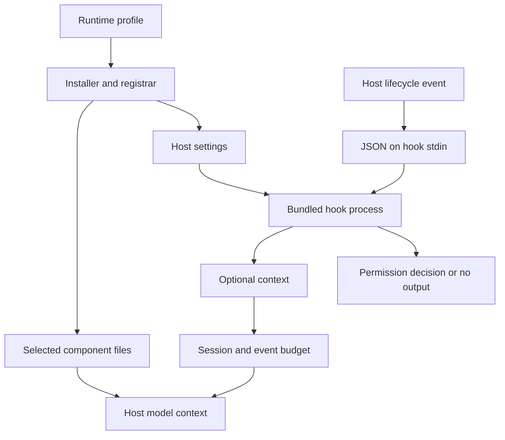

# Architecture

## Runtime boundary

vibecosystem is a file-based extension for coding hosts. The Claude adapter installs selected agents, skills, rules and bundled hooks. The Codex adapter installs skills and optionally a bounded TOML worker. There is no central agent executor, RPC mesh or guarantee that every instruction will be followed by a model.

A catalog entry is not an active component. The profile controls what the installer copies and registers. The host controls lifecycle events, permissions, agent execution and model context.

## Sources of truth

| Concern | Source |
| --- | --- |
| Profile inheritance, aliases and context limits | `profiles/runtime-manifest.json` |
| Domain-specific legacy profiles | `profiles/frontend.json`, `backend.json`, `fullstack.json`, `devops.json` |
| Claude hook registrations | `hooks/hooks.json` |
| Hook implementation | `hooks/src/` |
| Shipped hook bundles | `hooks/dist/` |
| Installer state and ownership | `~/.claude/vibecosystem-runtime.json` |
| Codex worker contract | `.codex/agents/luna-worker.toml` |
| Codex project defaults | `.codex/config.toml` |

The repository catalog contains 138 agent files, 296 top-level skill directories, 74 hook entry points and 20 rule files. Nested skills, registered commands and unique registered hook names are counted separately.

## Installation and profile selection

`install.sh` and the npm CLI call `tools/install-runtime.mjs`. `tools/profile-runtime.mjs` resolves profile inheritance and aliases. Selected files are installed into `~/.claude/`; hook commands are merged into `settings.json` through `tools/register-hooks.mjs`.

The default `core` profile provides bounded implementation and verification. `dashboard`, `quality`, `context`, `memory` and `orchestration` extend core. `full` selects the catalog and complete registration manifest. The old `minimal`/`smart` and `all` names are aliases for core and full respectively.

The installer records ownership. Profile changes reconcile files and registrations from earlier owned installations, preserve unrelated settings and create backups before replacing files. Unmanaged and locally modified content must not be silently treated as disposable. See [UPGRADING.md](UPGRADING.md) for operational details.

## Event flow

Claude sends event JSON through stdin. Tool input is in `tool_input`; PostToolUse output is in `tool_response`. Compatibility readers may accept earlier project-local names, but tests must exercise the canonical envelope.

Hook results must use the host-supported envelope. A context suggestion does not dispatch a new agent by itself. `PreToolUse` permission decisions remain intact when optional context has exhausted its budget.

## Context budget and usage

Participating injectors route their final context through `hooks/src/shared/context-budget.ts`. Lean profile limits are 4,000 characters per event and 12,000 per session; full limits are 8,000 and 50,000. Session identity separates independent runs. The budget is for hook-produced context, not the complete prompt or model's generated/reasoning tokens.

Persisted accounting enables independent hook processes to share the budget. Tests cover isolation, limits, truncation and competing writes. Missing or malformed state must not disable a permission decision. Expose omitted optional context through diagnostics where practical rather than implying retrieval succeeded.

The token tracker distinguishes provider usage from estimates. A character-based estimate is not a provider tokenization result or an invoice. Benchmarks must state the fixture, measured field, command and limitations; see [docs/verification.md](docs/verification.md).

## Components

Agents are Markdown with YAML frontmatter: a role, tools and optional Claude model metadata. Skills are directories containing `SKILL.md`; the top-level directory count differs from recursive SKILL.md count. Rules are host instructions and should be selected deliberately because always-loaded rules consume context.

The Codex installer does not convert Claude agent metadata into Codex model routing. It optionally installs `luna_worker`, whose canonical contract uses `gpt-5.6-luna` with `max` reasoning. Project settings remain model-neutral.

## Optional subsystems

| Subsystem | Behavior and dependencies |
| --- | --- |
| Memory and learning | Captures local patterns and consolidates them into recallable data; thresholds are heuristics requiring review |
| Memory graph | SQLite-backed graph through optional `better-sqlite3` |
| TLDR context | Queries a separately available daemon/tool; no result may mean unavailable rather than clean |
| Compiler diagnostics | Uses relevant project tools; optional assistance can contact a configured LM Studio endpoint |
| Dashboard | The opt-in `dashboard` profile adds one emitter to core: 7 unique hook entry points and 8 registrations, with agent starts on PreToolUse and structural completions on PostToolUse. Local HTTP/WebSocket service uses `ws`; see `tools/dashboard/README.md` |
| External actions | Braintrust requires `VIBECO_BRAINTRUST_ANALYSIS=1`; GitHub-mutating hooks require `VIBECO_GITHUB_AUTOMATION=1`; review data destinations and write authority |
| MCP and search skills | Instructions for separately configured providers; not provisioned by core installation |

Profiles that enable a subsystem do not provision its external binaries, accounts or services. A missing optional dependency must not be described as a successful analysis.

## Security boundaries

Hooks execute with the user's privileges and can inspect local files and tool data. The credential guard detects supported sensitive paths and command patterns; arbitrary shell parsing and indirect access make it unsuitable as a complete security boundary. Use host permissions, least-privilege credentials and an operating-system sandbox.

The dashboard is local by default. Browser origin checks reduce cross-site access to local endpoints; they do not authenticate other processes running as the same user. Logs and learned memory can contain sensitive material. See [SECURITY.md](SECURITY.md).

## Build and verification

TypeScript entry points are bundled by esbuild to ESM `.mjs` files. Runtime imports must work in emitted bundles, not just under the TypeScript test runner. Prebuilt bundles are committed for installation without a compilation step. Optional native dependencies remain explicit.

Run the hook type check, build, unit tests, emitted-bundle smoke tests and temporary-home installer tests. Parse generated JSON and TOML. Verify `git diff --exit-code hooks/dist/` after a clean rebuild before release. CI and [CONTRIBUTING.md](CONTRIBUTING.md) define the current commands.
