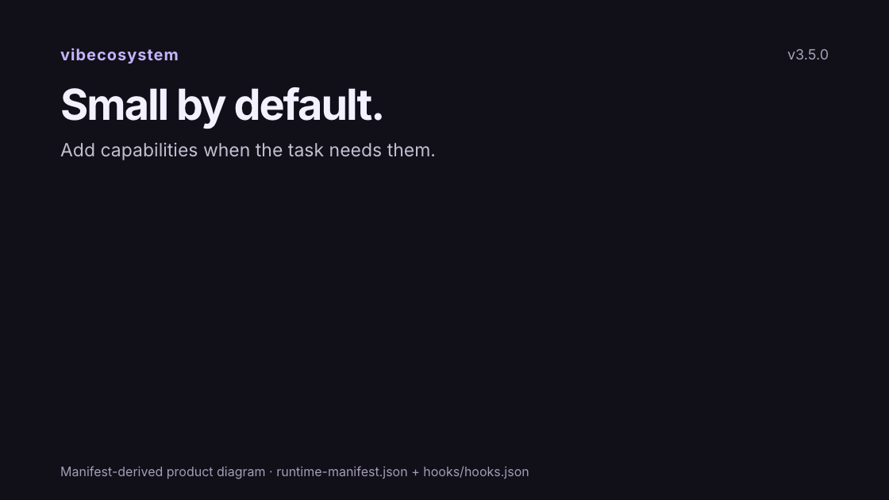
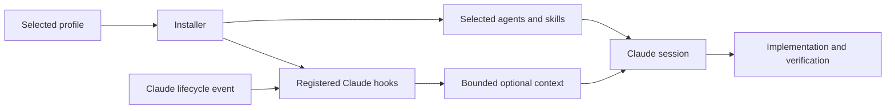

<div align="center">

# vibecosystem

**A focused runtime for Claude Code. A bounded worker for Codex.**

[](LICENSE)
[](#catalog)
[](#catalog)
[](#catalog)
[](#catalog)
[](https://github.com/vibeeval/vibecosystem/actions/workflows/validate.yml)

[Türkçe](#turkce) · [Español](docs/README_ES.md) · [Français](docs/README_FR.md) · [Deutsch](docs/README_DE.md) · [Português](docs/README_PT.md) · [Italiano](docs/README_IT.md) · [Nederlands](docs/README_NL.md) · [中文](docs/README_ZH.md) · [日本語](docs/README_JA.md) · [한국어](docs/README_KO.md) · [العربية](docs/README_AR.md) · [हिन्दी](docs/README_HI.md) · [Русский](docs/README_RU.md)



</div>

vibecosystem packages agents, skills and hooks for software work. The default `core` profile installs a selected set for investigation, implementation, review and verification. Memory, learning and orchestration have explicit profiles; the complete catalog is available through `full`.

**3.5.0 is a release candidate in this source tree.** It is not a claim that an npm package or GitHub release has been published. See [CHANGELOG.md](CHANGELOG.md) and the [upgrade guide](UPGRADING.md).

## Quick start

Use a source checkout to try these changes. When reviewing a PR, check out its head branch before installing; cloning uses `main` by default:

```bash
git clone https://github.com/vibeeval/vibecosystem.git
cd vibecosystem
./install.sh --profile core --dry-run
./install.sh --profile core
```

The installer uses the prebuilt hooks in `hooks/dist/`; a normal installation does not compile TypeScript or install the hook development dependencies. Node.js 18+ and Bash are required. Development checks use Node.js 22.

For the published npm version:

```bash
npx vibecosystem init --profile core
```

The remote installer is also available. Review the script before running it:

```bash
curl -fsSL https://raw.githubusercontent.com/vibeeval/vibecosystem/main/install-remote.sh -o install-remote.sh
bash install-remote.sh --profile core
```

Restart Claude Code after changing its hook registrations. Inspect the installed state with:

```bash
vibeco effective-config
vibeco doctor
vibeco stats
```

The source installer creates `~/.local/bin/vibeco` unless an unmanaged launcher already exists there. Add `~/.local/bin` to `PATH` if your shell cannot find it. You can also run the source CLI with `node tools/vibeco/vibeco.mjs`.

## Profiles

Profiles select installed components and registered hook commands. Catalog size does not describe how much prompt content is loaded into each request.

| Profile | Purpose |
| --- | --- |
| `core` | Selected implementation, investigation and verification tools; default |
| `dashboard` | Core plus opt-in local activity monitoring |
| `quality` | Core plus focused edit, compiler and security checks |
| `context` | Core plus targeted code context retrieval |
| `memory` | Core plus persistent recall and learning |
| `orchestration` | Core plus explicit multi-agent workflows |
| `full` | All catalog components and the complete hook registration manifest |

`minimal` and `smart` alias `core`; `all` aliases `full`. Legacy `frontend`, `backend`, `fullstack` and `devops` profiles retain domain allowlists with core hooks. Read the exact selection in [profiles/runtime-manifest.json](profiles/runtime-manifest.json), or use `vibeco effective-config` after installation.

```bash
vibeco profile quality
vibeco profile core
```

Profile changes reconcile installer-owned files and hook registrations. Modified or unmanaged files require review; the installer preserves ownership boundaries and creates backups before replacements. See [UPGRADING.md](UPGRADING.md).

## Token and runtime efficiency

The default profile avoids installing the complete agent and skill catalog. Context-producing hooks use character limits: **4,000 per event and 12,000 per session** for lean profiles; **8,000/50,000** for `full`. These are limits on participating hook context, not limits on total model input, output, reasoning, tool results or billing.

Token cost depends on the selected model, task, retrieved content and retries. Character counts and `estimated_tokens` are estimates; provider-reported usage is recorded separately when present. This project does not promise a fixed percentage or multiplier of token savings. Reproducible measurements belong with their fixtures and commands in [the verification record](docs/verification.md).

The core skill entrypoint payload is smaller after focused rewrites: see the [reproducible byte comparison](docs/verification.md#core-skill-entrypoint-payload). Skills load on demand, so this is an available instruction size measurement, not a whole-session token claim.

For routine work, stay on `core`, inspect relevant files, use one bounded implementation path and run the checks required for the change. Select `context`, `memory` or `orchestration` when the task benefits from them. Installing `full` does not automatically launch an agent swarm.

## How the runtime fits together



Hooks run in response to host lifecycle events. They can inspect tool input, return a permission decision or provide context. They do not guarantee that a suggested agent or workflow will execute. Agent and skill files are instructions consumed by the host model.

The optional memory pipeline captures and consolidates patterns under the user's Claude directory. Its thresholds are heuristics, not proof that a learned rule is correct. Review learned material before relying on it in sensitive work.

## Catalog

| Path | Catalog contents |
| --- | --- |
| `agents/` | 138 Markdown agent definitions |
| `skills/` | 296 top-level skill directories; some contain nested skills |
| `hooks/src/` | 74 TypeScript entry points, including utilities and CLIs |
| `rules/` | 20 rule documents; the lean profiles do not install the full rule set |

Source entry points, unique hook names and registered commands are different counts. [hooks/hooks.json](hooks/hooks.json) is the registration source. Some files are command-line utilities or are not registered by default. Use `vibeco list agents --search security` to browse the installed catalog.

## Codex and other adapters

| Host | Setup | Scope |
| --- | --- | --- |
| Claude Code | `./install.sh --profile core` | Selected agents, skills, hooks and rules |
| Codex | `./install-codex.sh --profile core --install-luna-worker` | Selected skills and an optional bounded `luna_worker` |
| Cursor | `./install-cursor.sh /path/to/project` | Project instructions, MDC rules and skills |
| Other compatible hosts | Manual | Skill content; check the host's format and discovery rules |

The Codex worker contract is [`.codex/agents/luna-worker.toml`](.codex/agents/luna-worker.toml): `gpt-5.6-luna` with `max` reasoning. The project config stays model-neutral. Claude-only `opus`/`sonnet` metadata is not applied by the Codex installer. Model availability and custom-agent support depend on the host and account. See [docs/codex-setup.md](docs/codex-setup.md).

## Optional integrations and data

Core installation does not provision external services. Some optional hooks and skills need tools that are not bundled:

- Code context and Python diagnostics use a compatible TLDR daemon; unavailable diagnostics can return no findings.
- Memory graph features need a Node-compatible `better-sqlite3` installed in `~/.claude/hooks/`; a missing or incompatible module is reported and that graph operation skips. Other recall workflows reference Python/`uv` scripts and may need a configured database.
- The `dashboard` profile adds one emitter to core (7 unique hook entry points across 8 registrations). It records agent starts on PreToolUse and structural tool completion events on PostToolUse; `full` includes it too. The dashboard uses the local `ws` package. Install it with `npm ci --ignore-scripts --prefix ~/.claude/tools/dashboard`, as described in [its setup guide](tools/dashboard/README.md).
- Compiler assistance may contact a configured LM Studio endpoint. Braintrust extraction requires `VIBECO_BRAINTRUST_ANALYSIS=1`, a key and its script. GitHub-mutating hooks require `VIBECO_GITHUB_AUTOMATION=1`. MCP, search and provider skills may contact their configured services.

Local state can contain code excerpts, prompts, tool output, errors and learned rules under `~/.claude/`. The core product is local; integrations may send data to the services you configure. Review the enabled profile, credentials and endpoint settings. The credential hook is a best-effort guard and does not replace host permissions or an operating-system sandbox. See [SECURITY.md](SECURITY.md).

## Development

```bash
cd hooks
npm ci
npm run check
npm run build
npm test
```

Keep `hooks/dist/` synchronized with source. Installer tests use temporary home directories; do not use a personal installation as a fixture. See [CONTRIBUTING.md](CONTRIBUTING.md), [ARCHITECTURE.md](ARCHITECTURE.md) and [docs/verification.md](docs/verification.md).

## Visuals

The current [seven-second GIF](assets/runtime-demo.gif) is a locally rendered product diagram, not a screen recording or benchmark. Its [editable source](assets/runtime-demo-source/README.md) freezes data from the runtime manifest. The [static diagram](assets/runtime-overview.svg) describes profile selection and runtime boundaries. Earlier terminal GIFs remain in `assets/` as historical material; they depict legacy workflows and are not evidence that every feature runs in the default profile. See [assets/README.md](assets/README.md) for sources and reproduction requirements.

<a name="turkce"></a>

## Türkçe

vibecosystem, Claude Code için agent, skill ve hook'ları bir araya getirir. Varsayılan `core` profili, araştırma, geliştirme, inceleme ve doğrulama için seçilmiş bileşenleri kurar. Bellek, öğrenme ve çoklu agent akışları ayrıca seçilir; katalogdaki her şey her oturumda yüklenmez.

```bash
./install.sh --profile core --dry-run
./install.sh --profile core
vibeco effective-config
```

Token verimliliği için önce göreve uygun küçük profili seç. Bağlam sınırları modelin toplam token tüketimini sınırlamaz; ücret ve kullanım görevine, modele ve tekrar sayısına bağlıdır. Ölçülmemiş tasarruf oranları vaat etmiyoruz. `full` profili tüm kataloğu açar; otomatik olarak bir agent ordusu başlatmaz.

3.5.0 bu kaynak ağacında hazırlanıyor. Yayınlanmış sürüm ve kurulum için İngilizce bölümü, değişiklikler için [CHANGELOG.md](CHANGELOG.md) dosyasını takip edebilirsin.

## Credits and license

Built by [@vibeeval](https://x.com/vibeeval). MIT licensed. See [LICENSE](LICENSE).

The catalog incorporates ideas credited in the individual skills and agent definitions, including work from Shannon, UI UX Pro Max, Game Studios, Skill Gateway, Pyxel, copilot-orchestra and Trail of Bits Skills. External tools and providers retain their own licenses and terms.
