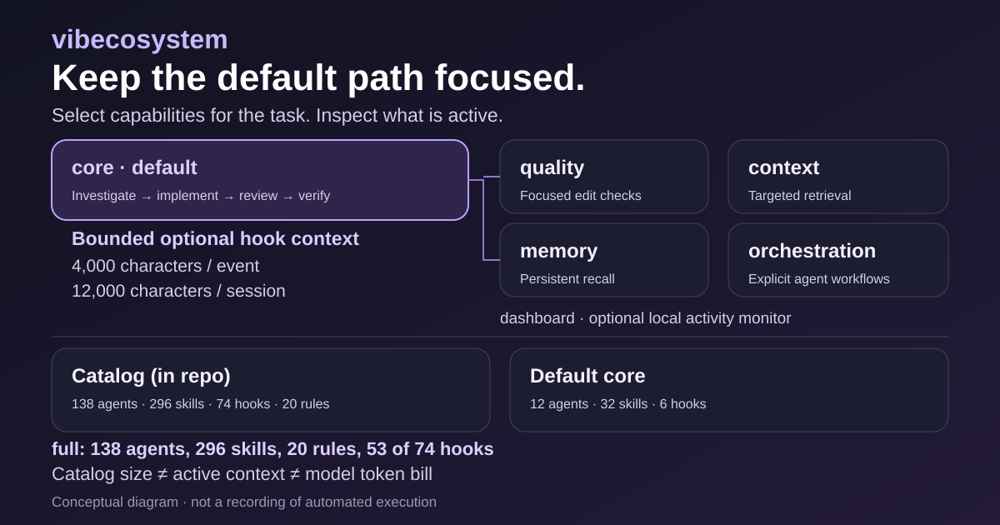

[English · canonical documentation](../README.md)

# vibecosystem — Italiano

**Un ambiente mirato per Claude Code e un worker limitato per Codex.**

Il profilo predefinito `core` installa componenti selezionati per analisi, implementazione, revisione e verifica. Memoria, apprendimento e orchestrazione si scelgono separatamente; installare l’intero catalogo non avvia automaticamente uno sciame di agenti.

Questa pagina è un’introduzione. Le istruzioni tecniche aggiornate, le dipendenze e i limiti sono nel README inglese.



## Avvio rapido

```bash
git clone https://github.com/vibeeval/vibecosystem.git
cd vibecosystem
./install.sh --profile core --dry-run
./install.sh --profile core
vibeco effective-config
```

La versione 3.5.0 è in preparazione in questo albero sorgente; non implica una pubblicazione su npm o GitHub. I limiti del contesto contano caratteri e non limitano il consumo totale del modello. Non è promessa una percentuale fissa di risparmio di token.

[Profiles and setup](../README.md#profiles) · [Codex](codex-setup.md) · [Upgrade guide](../UPGRADING.md) · [Security](../SECURITY.md) · [Verification](verification.md)
